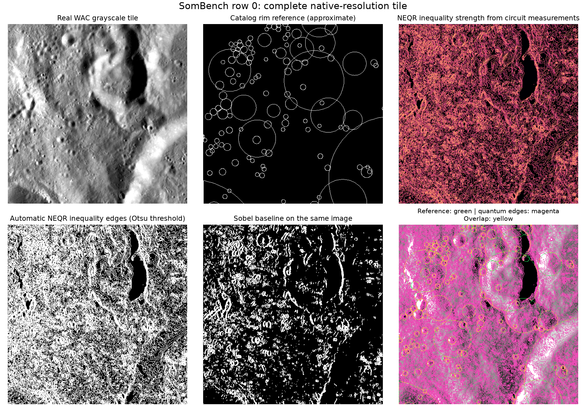
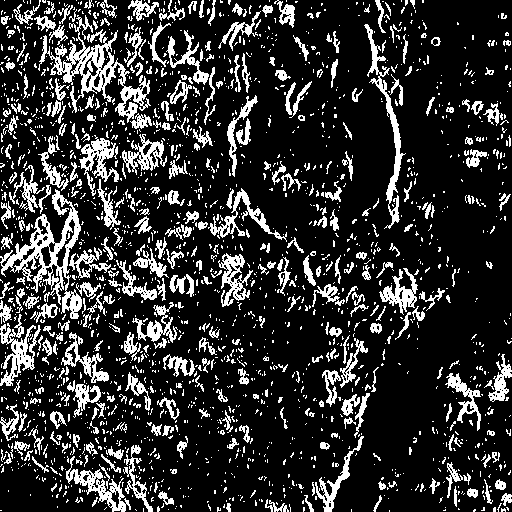
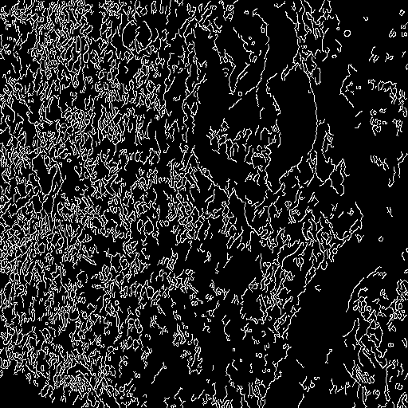
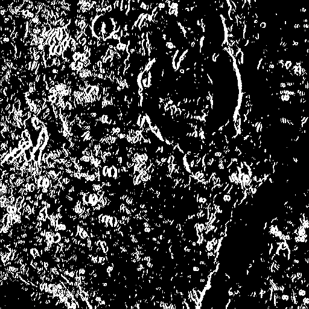

# Real lunar tile: automatic quantum edge detection

Tile: `M1290203799CE_r5872_c1112`; viewer metadata row 0; annotation split `train`.

Processed all 512x512 pixels using 5,476 Qiskit circuits and 44,859,392 measurement shots.
Elapsed circuit workload: 241.4 seconds. No manual region selection was used.

Every detected edge is reconstructed from Aer circuit counts. The full-image output does not use the analytical shortcut or a classical edge detector.
Classical processing prepares grayscale intensities,  calibrates measured probabilities, stitches halos and thresholds the final map.
Aer is an ideal local statevector simulator; this is not quantum hardware execution. Image preparation is executed with Aer's supported Initialize instruction. A decomposed preparation example is saved as QASM.

## Metrics against catalog-derived approximate rims

| Method | Exact F1 | 1px F1 | 2px F1 | Average precision |
| --- | ---: | ---: | ---: | ---: |
| NEQR-Interference (measured) | 0.0804 | 0.2394 | 0.3571 | 0.0421 |
| Sobel | 0.1065 | 0.3148 | 0.4658 | 0.0550 |
| Canny | 0.0715 | 0.2442 | 0.3790 | 0.0368 |
| Robinson | 0.1070 | 0.3161 | 0.4672 | 0.0553 |

NEQR quantum inequality between neighboring 4-bit intensities; not a gradient magnitude
Labels are circular catalog approximations, not pixel-perfect image-traced boundaries. This is a single train-split demonstration, not a held-out crater detection benchmark.
Outputs are edge maps, not detected crater bounding boxes. Illumination, texture, catalog incompleteness and finite shot noise affect the results.

Source: https://huggingface.co/datasets/nasa-ibm-ai4science/Sombench-WAC-Crater-Detection

## Detector comparison on the same working input

| Method | Edge pixels | Coverage |
| --- | ---: | ---: |
| NEQR-Interference (measured) | 150,672 | 57.48% |
| Sobel | 50,107 | 19.11% |
| Canny | 37,566 | 14.33% |
| Robinson | 51,001 | 19.46% |

Coverage measures how many pixels are marked as edges; it does not measure accuracy.
Sobel and Robinson use Otsu thresholds; Canny uses automatic median thresholds.

